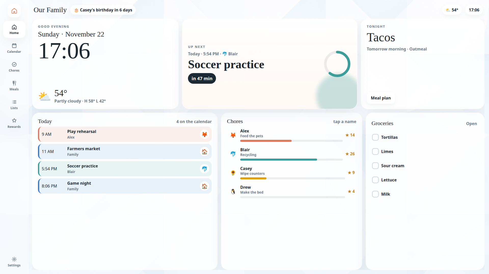
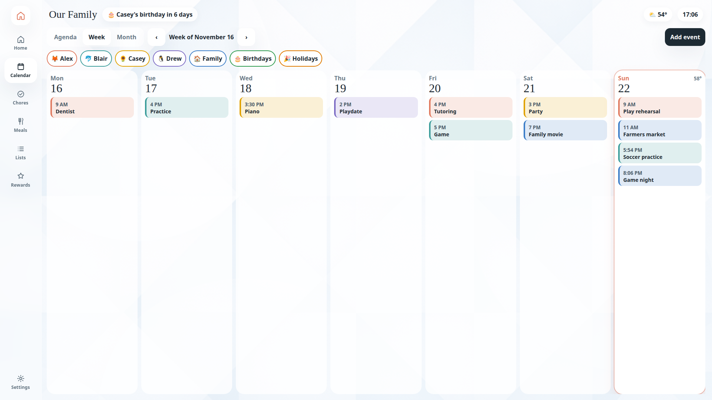
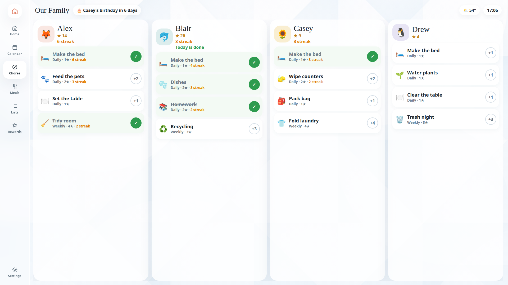
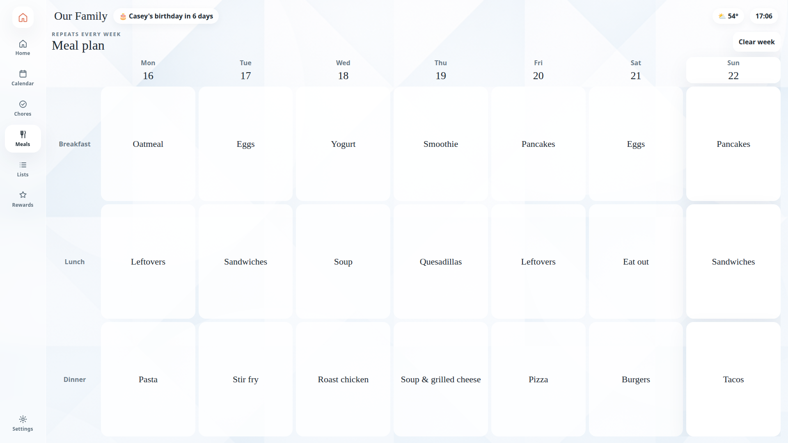
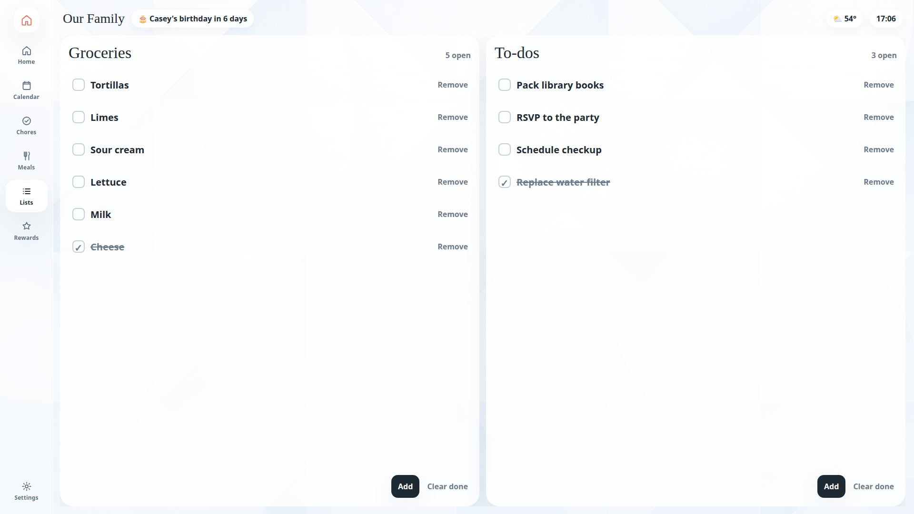
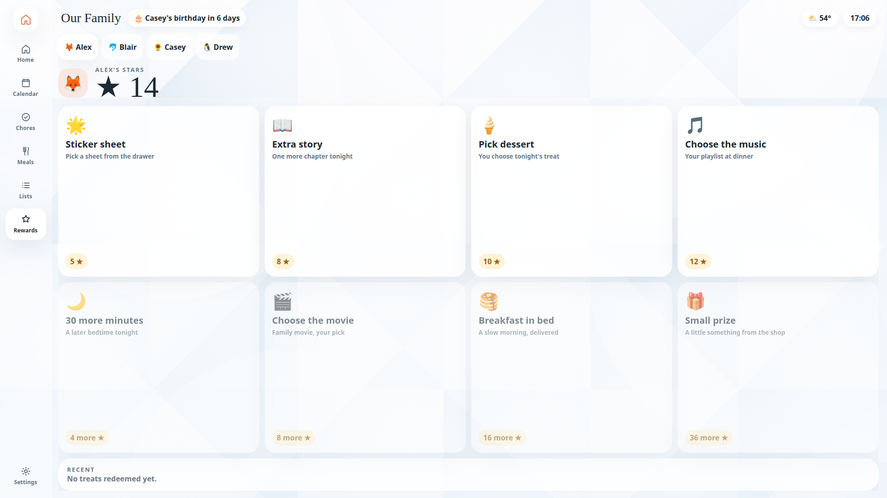
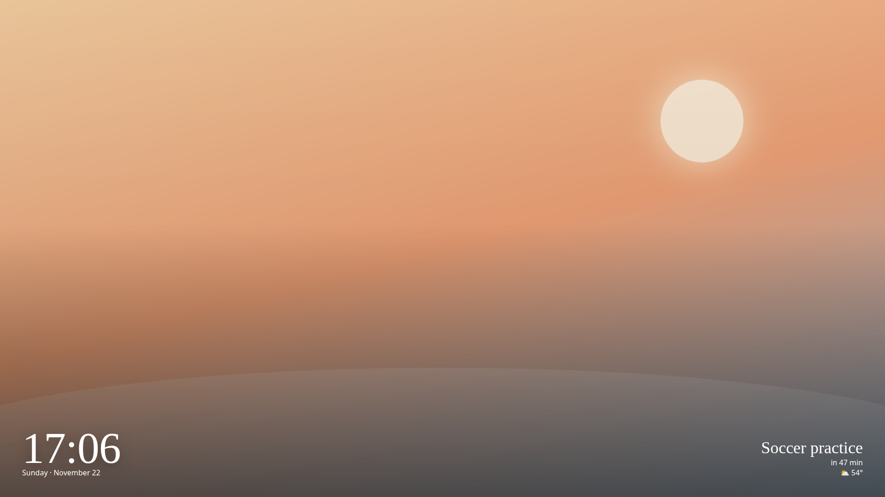
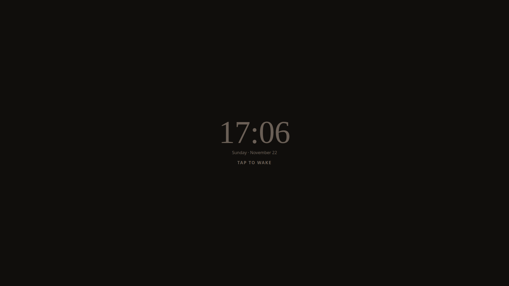

<div align="right">
  <details>
    <summary >🌐 Language</summary>
    <div>
      <div align="center">
        <a href="https://openaitx.github.io/view.html?user=mohesles&project=my-skylight-calendar&lang=en">English</a>
        | <a href="https://openaitx.github.io/view.html?user=mohesles&project=my-skylight-calendar&lang=zh-CN">简体中文</a>
        | <a href="https://openaitx.github.io/view.html?user=mohesles&project=my-skylight-calendar&lang=zh-TW">繁體中文</a>
        | <a href="https://openaitx.github.io/view.html?user=mohesles&project=my-skylight-calendar&lang=ja">日本語</a>
        | <a href="https://openaitx.github.io/view.html?user=mohesles&project=my-skylight-calendar&lang=ko">한국어</a>
        | <a href="https://openaitx.github.io/view.html?user=mohesles&project=my-skylight-calendar&lang=hi">हिन्दी</a>
        | <a href="https://openaitx.github.io/view.html?user=mohesles&project=my-skylight-calendar&lang=th">ไทย</a>
        | <a href="https://openaitx.github.io/view.html?user=mohesles&project=my-skylight-calendar&lang=fr">Français</a>
        | <a href="https://openaitx.github.io/view.html?user=mohesles&project=my-skylight-calendar&lang=de">Deutsch</a>
        | <a href="https://openaitx.github.io/view.html?user=mohesles&project=my-skylight-calendar&lang=es">Español</a>
        | <a href="https://openaitx.github.io/view.html?user=mohesles&project=my-skylight-calendar&lang=it">Italiano</a>
        | <a href="https://openaitx.github.io/view.html?user=mohesles&project=my-skylight-calendar&lang=ru">Русский</a>
        | <a href="https://openaitx.github.io/view.html?user=mohesles&project=my-skylight-calendar&lang=pt">Português</a>
        | <a href="https://openaitx.github.io/view.html?user=mohesles&project=my-skylight-calendar&lang=nl">Nederlands</a>
        | <a href="https://openaitx.github.io/view.html?user=mohesles&project=my-skylight-calendar&lang=pl">Polski</a>
        | <a href="https://openaitx.github.io/view.html?user=mohesles&project=my-skylight-calendar&lang=ar">العربية</a>
        | <a href="https://openaitx.github.io/view.html?user=mohesles&project=my-skylight-calendar&lang=fa">فارسی</a>
        | <a href="https://openaitx.github.io/view.html?user=mohesles&project=my-skylight-calendar&lang=tr">Türkçe</a>
        | <a href="https://openaitx.github.io/view.html?user=mohesles&project=my-skylight-calendar&lang=vi">Tiếng Việt</a>
        | <a href="https://openaitx.github.io/view.html?user=mohesles&project=my-skylight-calendar&lang=id">Bahasa Indonesia</a>
        | <a href="https://openaitx.github.io/view.html?user=mohesles&project=my-skylight-calendar&lang=as">অসমীয়া</
      </div>
    </div>
  </details>
</div>

# DIY Smart Home Family Calendar (Skylight Clone)


## 📖 Introduction

My wife has been recently bombarded in social media with ads for smart home calendars (Skylight, Cozyla, Hearth) and was ready to spend over $300 on one. Before giving her the green light, I asked for a chance to research them.

I realized most offered similar functionality but differed significantly in price. Most importantly, I didn't see any outstanding feature that I couldn't implement in **Home Assistant**.

**The Goal:** A WAF-approved (Wife Acceptance Factor), countertop-friendly touchscreen calendar that integrates deep into our smart home without monthly fees.

## 💡 Why DIY?

Choosing the DIY route with Home Assistant provided several benefits over buying a Skylight/Hearth display:

* **No Monthly Fees:** Avoids subscriptions for "premium" features.
* **Seamless Integration:** It talks to our lights, chores (Grocy), and presence sensors.
* **Old Hardware:** Repurposed a Mini PC and a standard monitor.
* **Privacy:** No vendor lock-in or risk of the company shutting down.

## Hardware

The wall UI is aimed at a **21.5-inch 1920×1080 landscape** touchscreen running Chromium in kiosk mode. Home Assistant stays on a separate always-on computer on the same Wi-Fi. The screen only loads the dashboard URL.

A 15-inch countertop touchscreen still works if you can stand close enough to read it. This layout is not a phone layout.

## What you get

One app, not a pile of unrelated cards. The left rail switches Home, Calendar, Chores, Meals, Lists, and Rewards.



* **Home.** Clock, weather, the next event with a countdown, tonight's dinner, today's agenda, chore progress, and the grocery list.
* **Calendar.** Agenda, week, and month for the family calendars, birthdays, and holidays. Filters per person. Add an event from big chips, with the on-screen keyboard only when the title is custom.
* **Chores.** Daily and weekly chores per person. Tap to complete, tap again to undo. Stars, streaks, and a short celebration when a chore is finished.
* **Meals.** A weekly breakfast, lunch, and dinner grid. It repeats until you change it. Preset meals, or type your own.
* **Lists.** Groceries and a family to-do list, backed by Home Assistant `todo` entities so the phone app stays in sync.
* **Rewards.** A star shop. Redeem a treat and the balance drops.
* **Screensaver.** After the screen sits idle, photos Ken Burns across the display with the clock, weather, and what's next. Touch anywhere to come back. With no photos yet, it uses a painted sunset.
* **Night.** The screen dims before bedtime and goes nearly black on a schedule. Touch to wake. Another idle stretch puts it back to sleep.









## The only place to name the family

Edit **`www/skylight-wall/household.json`** (on the HA host: `/config/www/skylight-wall/household.json`). Then refresh the wall browser. You do not restart Home Assistant for name, color, chore, or reward changes.

That file holds:

| Field | What to change |
| --- | --- |
| `family_name` | Name in the header |
| `members[].name`, `avatar`, `color` | The four people |
| `members[].calendar` | Their calendar entity, such as `calendar.alex` |
| `members[].person_entity` | Optional `person.*` entity for a presence dot. Leave `""` if you don't have one |
| `calendars` | Family, birthdays, and holidays entities |
| `chores` | Label, daily or weekly, star value, icon. A blank `name` hides that slot |
| `rewards` | Shop items and star costs |
| `meal_presets`, `event_presets`, `list_presets` | Big tap targets, so common entries need no typing |
| `lists.groceries` and `lists.todos` | Todo entity ids |

Keep member ids `p1`–`p4` and chore slots `1`–`8`. Those match helpers created by the package. Sample names (Alex, Blair, Casey, Drew) are placeholders.

## Install

### 1. Let Home Assistant load packages and themes

In `configuration.yaml`:

```yaml
homeassistant:
  packages: !include_dir_named packages

frontend:
  themes: !include_dir_merge_named themes
```

`default_config:` already enables the shopping list (`todo.shopping_list`). If you removed `default_config:`, add `shopping_list:` yourself.

### 2. Copy the files

From this repo into the Home Assistant config directory:

| Repo | Home Assistant |
| --- | --- |
| `packages/family_calendar.yaml` | `/config/packages/family_calendar.yaml` |
| `themes/skylight.yaml` | `/config/themes/skylight.yaml` |
| `www/skylight-wall/` (the whole folder) | `/config/www/skylight-wall/` |
| `calbackgrd.png` | `/config/www/calbackgrd.png` |

`/config/www/` is served as `/local/`.

### 3. Register the wall card

The wall is one local Lovelace module. It is not a HACS download. In **Settings → Dashboards → Resources → Add resource**:

* URL: `/local/skylight-wall/skylight-wall-card.js?v=1`
* Type: JavaScript module

Bump the `?v=` number after you replace the file, or Home Assistant will keep the old copy.

### 4. Create the dashboard

1. **Settings → Dashboards → Add dashboard → New dashboard from scratch.**
2. Give it a URL path you will remember, such as `skylight`.
3. Open the raw configuration editor and paste [`dashboard.yaml`](dashboard.yaml).
4. Set the theme to **Skylight** (profile menu, or the theme key already on the view).

Search `dashboard.yaml` for `# <--- UPDATE THIS ENTITY` and set `weather_entity` to your weather entity. Calendar ids are **not** in this file. They live in `household.json`.

### 5. Restart, then name the calendars

Restart Home Assistant so the package creates the helpers, scripts, and automations.

Create or rename calendars (Google Calendar or Local Calendar) and put their entity ids in `household.json`:

* one calendar per person (`members[].calendar`)
* `calendar.family`, `calendar.birthdays`, and `calendar.holidays` unless you point the `calendars` entries somewhere else

Holidays: **Settings → Devices & services → Add integration → Holiday**, then confirm the entity id.

The legacy "add event" script in the package still has its own `# <--- UPDATE THIS ENTITY` map. The wall does not use that script. It calls `calendar.create_event` with the entity from `household.json`. Update the map only if you still call `script.add_google_calendar_event` yourself.

### 6. Lists that sync to the phone

* **Groceries.** `todo.shopping_list` from the built-in shopping list. Confirm the id under Developer Tools → States. If it differs, set `lists.groceries` in `household.json`.
* **To-dos.** Settings → Devices & services → Add integration → **Local to-do**. Create a list named **Family Tasks**. The entity is usually `todo.family_tasks`. Put the real id in `lists.todos`.

Add and check items on the wall or in the Home Assistant companion app. They are the same todo entities.

### 7. Photos

The screensaver tries these, in order:

1. **Media source.** Put images in `/media/photos` (Media → local media → a folder named `photos`). The card browses `media-source://media_source/local/photos`.
2. **www folder.** Put images in `/config/www/photos`. An automation writes `/config/www/photos/manifest.json` at startup and every six hours (`shell_command.skylight_photo_manifest`, which needs `python3` on the HA host). You can also run `python3 tools/make_photo_manifest.py /config/www/photos` by hand.
3. **No photos yet.** A painted sunset with the clock and the next event, so the idle screen is still calm.

Touch anywhere to leave the screensaver. Idle time defaults to 5 minutes. Change it from the gear at the bottom of the rail.

### 8. Sleep schedule

Defaults: dim the screen over the half hour before **21:30**, blank it until **06:30**, and stay awake for **10 minutes** after a tap. Further taps during the night keep extending that wake window. Change the times from the gear menu, or from the helpers:

* `input_boolean.skylight_sleep_enabled`
* `input_datetime.skylight_sleep_start`
* `input_datetime.skylight_sleep_end`
* `input_number.skylight_wake_minutes`
* `input_number.skylight_idle_minutes`
* `input_boolean.skylight_sound`

`input_boolean.skylight_asleep` turns on during the sleep window even if nobody has touched the wall. Use it to cut power to a smart plug or monitor. A commented example sits at the bottom of `packages/family_calendar.yaml`. Uncomment it only after the switch entity exists.

### 9. Kiosk

On the wall computer, open Chromium to the dashboard and hide Home Assistant chrome:

```text
http://<home-assistant-host>:8123/skylight/home?kiosk
```

Use the URL path you chose in step 4 if it is not `skylight`. `?kiosk` hides the header and sidebar.

Useful Chromium flags on the wall PC:

```text
chromium --kiosk --start-fullscreen --noerrdialogs --disable-session-crashed-bubble \
  http://<home-assistant-host>:8123/skylight/home?kiosk
```

Leave the operating system's on-screen keyboard off. The wall draws its own keys for meals, lists, and event titles. If both keyboards appear, disable the OS one.

If the panel has its own sleep timer, either turn that off and let this dashboard blank the page, or use `input_boolean.skylight_asleep` to actually cut the backlight. A CSS dim cannot turn off the backlight by itself.

Log the kiosk browser into Home Assistant once and let it keep the session.

## What you no longer need from HACS

The wall card replaces the old stack of cards. You do **not** need `week-planner-card`, `bubble-card`, `config-template-card`, `button-card`, `layout-card`, `better-moment-card`, or `weather-card` for this dashboard.

`browser_mod` is only used by the legacy `script.add_google_calendar_event` popup closer. The wall does not need it.

`card-mod` is optional. The Skylight theme uses it to load fonts for the rest of Home Assistant. The wall card ships Ovo and Nunito itself (SIL Open Font License).

## How chores and stars are stored

The package creates, for each of `p1`–`p4` and slots `1`–`8`:

* `input_datetime.skylight_p1_c1_done` — last completion date (`2000-01-01` means never)
* `counter.skylight_p1_c1_streak`
* `counter.skylight_p1_stars`
* `input_text.skylight_p1_rewards` — short redemption log

Meals are 21 text helpers, `input_text.skylight_meal_mon_breakfast` through `input_text.skylight_meal_sun_dinner`. They are a repeating week, not a dated history. "Clear week" empties them.

The wall decides the new streak, then `script.skylight_complete_chore` stores it. Completing yesterday's chore continues the streak. Missing a day shows the streak as broken until the next completion starts it over. Undo removes the stars for that tap.

## Blank calendar bug

Upstream [issue #33](https://github.com/mohesles/my-skylight-calendar/issues/33) and [PR #36](https://github.com/mohesles/my-skylight-calendar/pull/36): `dashboard.yaml` used to contain this inside a `config-template-card` script:

```text
return 'monday'; # <--- UPDATE THIS IF NEEDED
```

That block is JavaScript. `#` does not comment JavaScript out, `config-template-card` threw a `SyntaxError`, and the whole calendar rendered blank. This dashboard has no embedded JavaScript. The note in `dashboard.yaml` only records why that line is gone.

## Preview without Home Assistant

From the repo root:

```text
python3 -m http.server 8765
```

Open `http://127.0.0.1:8765/preview/index.html`. Add `?view=chores`, `meals`, `lists`, `rewards`, `saver`, `sleep`, or `settings`. The page uses sample events and does not write to Home Assistant. `node --test tools/logic.test.mjs` checks streak, sleep, and countdown rules.

## Known limits

* Four people, eight chore slots each. A fifth person means new helpers, a wider allow-list in `script.skylight_complete_chore`, and `p5` in `household.json`.
* The meal plan repeats every week. It does not keep a different menu for next month.
* The wall can create calendar events. Home Assistant has no supported delete service, so edits and deletes stay on the phone.
* Todo lists are not created by YAML. The shopping list comes from core. The family to-do list is a one-time Local to-do entry.
* Photo listing needs the media browser or `manifest.json`. A folder of files with no manifest and no media source will not appear.
* Sleep and the screensaver run in the browser. They do not power off the panel unless an automation listens to `input_boolean.skylight_asleep`.
* The on-screen keyboard is a large A–Z board with a space and delete key. It is not a full international input method.
* Stars live in Home Assistant counters, not in Grocy.
* The layout targets 1920×1080. Smaller windows scroll. There is no separate phone layout.
* `shell_command.skylight_photo_manifest` needs `python3` inside the Home Assistant environment. Media-source photos still work if that command fails.
